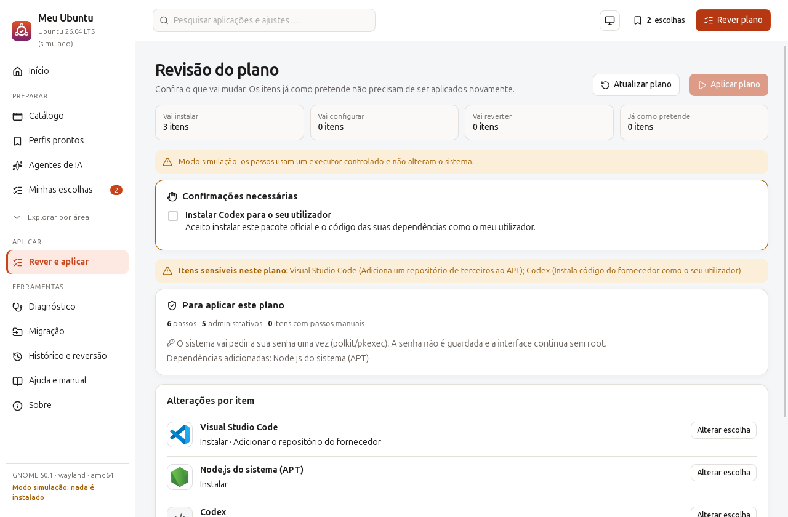

# Contexto e evolução do Meu Ubuntu

Registo histórico até à RC.3. O estado atual está no [README](../README.md) e na [matriz de aceitação](release-1.0.md). Referências a artefactos descrevem os builds da época, guardados localmente ou nos canais de distribuição.

Central visual pessoal de pós-instalação do Ubuntu 26.04: escolher aplicações, ajustes do GNOME, extensões e otimizações justificadas, rever um plano concreto, executar com autorização do sistema, verificar o resultado real, guardar perfis e reverter ajustes individualmente.

Go + Wails v2.16.0 + React/TypeScript. A interface, os ícones, o catálogo e os perfis iniciais vão embutidos no binário (`go:embed`), sem CDN nem fontes remotas.



## Documentação

- [Manual completo](manual.md): também em **Ajuda e manual**, sem internet, e em `meu-ubuntu --manual`.
- [Catálogo e perfis](catalogo.md): referência integral das receitas, opções, dependências, fontes e verificações.
- [Desenvolvimento](desenvolvimento.md): arquitetura, ponte, formato de perfis, segurança, testes e lançamento.
- [Aceitação da 1.0](release-1.0.md): resultados da candidata e validações ainda pendentes.

A candidata **1.0.0-rc.3** acrescenta pacotes opcionais de integração com diagnóstico e guias manuais. Inclui exportação do diagnóstico em **PDF, CSV e Excel (.xlsx)** e corrige recuperação de operações parciais, revisão de reversões, verificação após instalação e identificação do grupo Docker. Mantém agentes de IA, grupos de complementos, serviços locais e Sobre sempre acessível. Consulte o [roteiro de teste](beta-usabilidade.md) e a [revisão adversarial da RC.1](../dogfood-output/rc.1/review-astra-high.md).

Alvo: **Ubuntu 26.04 LTS, GNOME, amd64**. Esta é uma candidata para testes; atualização, polkit e cenários GNOME/Wayland reais precisam de validação antes da versão estável. O build usa Go 1.26.9.

## Executar noutro PC (Ubuntu 26.04 desktop)

Copie **um** dos artefactos de `dist/` e confirme o checksum:

```bash
sha256sum -c SHA256SUMS --ignore-missing
```

**Opção A — binário (sem instalar nada):**
```bash
cp meu-ubuntu-1.0.0-rc.3-linux-amd64 ~/meu-ubuntu && chmod +x ~/meu-ubuntu
~/meu-ubuntu --simular     # primeiro: modo simulação, nada é instalado
~/meu-ubuntu               # depois: modo real
```
Copie-o para a sua pasta pessoal. Uma pen montada com `noexec` impede a execução, e o pkexec exige um caminho local.

**Opção B — .deb (declara as dependências e cria um atalho no menu):**
```bash
sudo apt install ./meu-ubuntu_1.0.0-rc.3_amd64.deb
meu-ubuntu
```

Não precisa de Go, Node nem npm. Bibliotecas de execução: `libwebkit2gtk-4.1-0`, `libgtk-3-0t64`, `pkexec` e `gnupg`. Uma simulação de instalação no 26.04 mostrou que o `ubuntu-desktop-minimal` já as puxa, por isso o binário deve abrir numa instalação desktop limpa. O .deb declara-as de qualquer forma.

**Nunca execute com `sudo`** (a aplicação recusa arrancar como root). As operações administrativas pedem a senha pela janela normal do sistema (polkit/pkexec), conforme a política da sessão; a revisão de snapshots administrativos também pode pedir autorização.

## Preparação da 1.0.0 open source

A 1.0.0 terá como alvo Ubuntu 26.04, GNOME e amd64. Fedora, outras versões do Ubuntu e outras arquiteturas precisam de adaptadores e testes próprios; ficam para depois deste lançamento. O catálogo atual é suficiente: a prioridade é conseguir concluir, repetir e recuperar os fluxos com confiança.

Aplicação local gratuita, licenciada sob **GNU GPLv3 (GPL-3.0-only)**. Suporte, implantação e operação gerida podem ser serviços pagos no futuro. Consulte [LICENSE](../LICENSE), [avisos de terceiros](../NOTICE.md), [contribuição](../CONTRIBUTING.md) e [segurança](../SECURITY.md). O código-fonte correspondente acompanha a candidata; o [repositório público](https://github.com/mercynet/my-ubuntu) já está disponível; a publicação da versão estável depende da validação desktop e do beta.

### Escopo do lançamento

- Manter catálogo, aplicações, agentes de IA, grupos de plugins, serviços locais, ajustes, perfis, revisão, execução, diagnóstico, histórico, reversão, manual e Sobre.
- Exportar o diagnóstico em **PDF, CSV e XLSX**, com todas as secções selecionadas, data, versão e modo. Os formatos partilham os mesmos registos; CSV neutraliza fórmulas e XLSX guarda texto. O PDF representa caracteres Unicode suplementares pelo seu código.
- Validar o catálogo existente no Ubuntu suportado. Receitas sem verificação adequada ficam manuais ou indisponíveis; a contagem de ferramentas não é um critério de lançamento.
- Gestão remota de várias máquinas, Windows, macOS, outras distribuições e novos perfis profissionais pertencem ao roteiro posterior à 1.0.

**Derivadas do Ubuntu:** Linux Mint, Zorin e outras derivadas não têm suporte confirmado nesta versão. A deteção e o helper recusam as receitas APT quando a distribuição não se identifica como `ubuntu`; remover essa condição não valida pacotes, repositórios ou ambiente gráfico. Mint 22.x usa a base Ubuntu 24.04 e oferece Cinnamon/MATE/Xfce ([versões oficiais](https://linuxmint.com/download_all.php), [notas da 22.3](https://linuxmint.com/rel_zena.php)); Zorin 18.1 também usa Ubuntu 24.04 ([detalhes oficiais](https://zorin.com/os/details/)). Compatibilidade futura requer identificar separadamente distribuição, versão da base e desktop, adaptar as receitas e testar instalação/atualização nessa combinação. O alvo da 1.0 continua Ubuntu 26.04 com GNOME.

### Ordem de execução e aceitação

| Etapa | Entrega | Critério para avançar |
|---|---|---|
| 1. Recuperação e revisão | Resolver os sete achados do Astra e proteger/validar o fecho durante execução | Reproduções dirigidas, regressões e comportamento após reabrir conferidos; nenhum bloqueante conhecido por resolver |
| 2. Funcionalidades e catálogo | Exportação PDF/CSV/XLSX; percursos atuais e receitas auditados | Exportações abrem em leitores PDF/LibreOffice; dados coerentes; executar duas vezes não desfaz escolhas nem repete trabalho concluído |
| 3. Preparação open source | Licença principal, atribuições, instruções de contribuição, política de segurança, changelog e repositório público preparados | Construir a partir do código publicado; documentar o canal de bugs e o de relatos privados de segurança; pacote inclui avisos aplicáveis |
| 4. Beta com pessoas | Convidar os amigos que usam Ubuntu 26.04, começando por simulação e planos pequenos | Meta proposta: pelo menos cinco participantes, incluindo instalação limpa e atualização; tarefas concluídas sem orientação contínua e dificuldades registadas |
| 5. Candidata | `1.0.0-rc.3`, código e artefactos da mesma revisão | Checks, auditoria, build/verificação e matriz desktop aprovados; falhas do beta corrigidas e novamente exercitadas |
| 6. Publicação | Código-fonte, binário, .deb, checksums, notas e limites de suporte | Publicar exatamente a candidata aprovada, com licença definida e instruções testadas; divulgar os canais de contribuição |

A candidata em preparação é **1.0.0-rc.3**. Inclui suporte genérico opcional a pacotes de integração; o pacote OfficeGest específico fica fora da distribuição. Os resultados da RC.1 abaixo pertencem à versão anteriormente validada, e a nova candidata exige checks próprios. As correções dirigidas foram reproduzidas, testadas e revistas pelo Astra/high, sem bloqueadores de código remanescentes nos cenários revistos. A matriz desktop e o feedback externo continuam pendentes; publicar é uma etapa posterior à validação.

### Correções que precedem a candidata

A [revisão original Astra/high](../dogfood-output/review-astra-high-2026-10-12.md) identificou os casos abaixo. As correções e regressões estão conferidas na [revisão final da RC](../dogfood-output/rc.1/review-astra-high.md); o fecho em GNOME e as operações administrativas reais exigem validação desktop:

1. Retomar uma reversão parcial sem voltar a alterar as chaves já restauradas.
2. Retomar pós-operações e recargas que falharam, distinguindo pacote instalado, ficheiro gravado e configuração efetiva.
3. Incluir valores atuais/alvo das reversões no plano e recusar execução quando mudarem depois da revisão.
4. Retirar da ponte pública a reversão forçada que contorna a revisão.
5. Distinguir pertença persistente ao grupo Docker de grupos ativos na sessão.
6. Guardar a causa de uma intervenção no histórico e disponibilizar nova verificação/configuração; não apresentar uma execução com intervenção como sucesso completo.
7. Reconhecer corretamente o código de saída Git que significa preferência ausente.
8. Proteger o fecho normal durante operações, respeitando um limite seguro; validar interrupção e retoma numa VM descartável. A revisão não demonstrou corrupção de pacotes ao fechar a janela.

O utilizador confirmou uma instalação real bem-sucedida de ferramentas neste PC com uma versão anterior. Em 2026-10-12, a leitura do pacote instalado e de `meu-ubuntu --version` confirmou **0.3.2**; o ambiente atual é **Ubuntu 26.04.1 LTS, GNOME 50.1, Wayland**. Isso comprova uso real anterior e identifica a instalação atual, sem atribuir ao relato cenários ou uma subversão histórica que não foram especificados. A próxima validação deve focar a atualização desta instalação para a candidata e os fluxos alterados.

| Critério de lançamento | Evidência exigida | Estado |
|---|---|---|
| Experiência completa | Assistente → escolhas → revisão → execução → resultado → guardar/reutilizar perfil; falha e nova tentativa preservam escolhas | Instalação real anterior bem-sucedida relatada pelo utilizador; regressões das betas registadas em `dogfood-output/`; atualização da candidata no PC pendente |
| Segurança e recuperação | Auditoria Go/npm sem alertas bloqueantes; revisão do helper, scripts transferidos, importação e reversão; nenhuma instalação sem revisão | Achados Astra corrigidos, regressões e revisão final aprovadas; fecho normal protegido; fecho e polkit em GNOME real pendentes |
| Distribuição | Binário e `.deb` da mesma revisão, checksums, instalação/atualização sem ferramentas de desenvolvimento e dados preservados | Build/verificação automatizados e instalação do pacote em container limpo; falta validar a atualização da 0.3.2 para a candidata no desktop |
| Desktop real | Ubuntu 26.04 com GNOME/Wayland: autenticar/cancelar polkit, aplicar e reverter preferências, extensões, energia e Firefox | Ambiente atual confirmado: Ubuntu 26.04.1, GNOME 50.1 e Wayland; relato anterior de instalação bem-sucedida; cenários específicos da candidata ainda por registar |
| Exportação de diagnóstico | PDF, CSV e XLSX reproduzem as secções escolhidas e abrem em leitores comuns | Leitores independentes e diálogo nativo GTK em simulação aprovados; CSV/XLSX iguais com 49 registos, cancelamento e extensão errada conferidos |
| Publicação open source | Licença principal explícita, avisos de terceiros e instruções para compilar, contribuir e relatar falhas | GPLv3, avisos, guias e código-fonte no pacote local; repositório público disponível e CI remota aprovada em 2026-10-13; validação desktop pendente |
| Release candidate | A mesma versão testada numa instalação limpa e numa atualização, mais uso diário por pelo menos dois utilizadores | Uso anterior confirmado; RC local preparada; atualização a partir da instalação 0.3.2 e feedback externo pendentes |

### Verificação no desktop antes da 1.0

Na instalação atual da 0.3.2, priorize atualizar para a candidata e conferir: seleção/perfis/histórico preservados, itens existentes marcados, grupos de plugins, serviços locais, acesso a Sobre, cópia e persistência dos guias, e repetir um plano que já funcionou na versão anterior. Use os cenários abaixo para completar a cobertura da candidata final, reaproveitando os resultados já confirmados.

Use uma VM ou máquina de teste com backup. Registe versão, sessão, hardware relevante e resultado de cada cenário:

1. Instalar o `.deb` num Ubuntu 26.04 limpo, abrir como utilizador normal e experimentar `--simular`.
2. Rever um plano pequeno (por exemplo, htop e tema escuro). Cancelar a autenticação, confirmar que não foi declarado sucesso e tentar de novo autorizando.
3. Aplicar o plano, reabrir a aplicação e voltar a revê-lo: itens já confirmados não devem repetir instalação. Exportar/importar o perfil e verificar as mesmas opções.
4. Provocar uma falha de rede e recuperar. Cancelar uma execução num limite seguro, reabrir e rever o que falta. Confirmar que o histórico explica o resultado parcial.
5. Reverter uma preferência. Alterá-la depois com as Definições do GNOME e confirmar que o Meu Ubuntu exige nova revisão/decisão explícita.
6. Testar extensões compatíveis, energia num portátil e o guia Oh My Zsh num terminal interativo. Firefox deve ser testado com um perfil de teste e backup; drivers/TRIM precisam de hardware e ambiente adequados.
7. Atualizar uma versão anterior para a candidata sem perder seleção, perfis, histórico ou marcas dos guias. Verificar teclado/foco, temas e ecrã a 900 px.

Problemas que possam perder dados, aplicar ações diferentes do plano ou declarar sucesso indevidamente bloqueiam o lançamento. Se uma receita não puder ser validada no destino, deve ficar manual ou indisponível na 1.0.

### Novidades da 0.4.0

- O início mostra o estado dos itens do seu perfil neste computador, com ações para rever o que falta, ajustar e guardar. Itens manuais e desconhecidos não entram na contagem de prontos.
- Guias com checklist pessoal persistente, comandos/configuração separados e cópia dos exemplos explícitos. As marcas não confirmam instalações; uma instrução alterada numa atualização não herda uma marca antiga. O guia aparece no catálogo, revisão e resultado.
- Falhar ao juntar/substituir um perfil mantém a revisão aberta e preserva a seleção. A operação bloqueia cliques repetidos e permite tentar de novo; guardar um perfil importado também mostra a falha no diálogo.
- `make check` compila os assets antes de verificar a aplicação Wails, incluindo numa cópia limpa, e executa `go vet` e testes com deteção de concorrência. `make test` é um alias.
- O compilador do build passa a Go 1.26.8, com arquivo oficial e SHA-256 fixos. A auditoria com o compilador anterior assinalou 17 alertas da biblioteca padrão; atualizar o compilador evita distribuir essas versões. A exposição concreta de cada alerta depende do caminho e plataforma utilizados. Fontes: [downloads Go](https://go.dev/dl/), [auditoria Go](https://go.dev/doc/security/vuln/).
- `make audit` verifica Go e npm; `make verify` confere checksums, versão dos binários e metadados do `.deb`. O teste de runtime escolhe uma versão explícita, mesmo quando existem pacotes antigos em `dist/`.
- Workflow de GitHub Actions preparado em `.github/workflows/check.yml`: checks, auditoria, build e artefactos, com ações fixadas por commit e permissão de leitura do repositório. Precisa de ser executado no repositório publicado; não publica uma release automaticamente.

## Novidades da 0.3.4

- Nala disponível no catálogo de Aplicações, com instalação pelo arquivo Ubuntu e exemplos de utilização no terminal.
- Novo complemento «Terminal produtivo»: Oh My Zsh com configuração guiada, sugestões pelo histórico, destaque de sintaxe, pesquisa com fzf, navegação com zoxide e exemplos com tldr/tealdeer.
- Oh My Zsh apresenta o instalador oficial versionado e as opções `--unattended --keep-zshrc`. As dependências são instaladas pelo plano; integrar a configuração pessoal é um passo manual. São sugeridos `git`, `colored-man-pages`, `command-not-found` e, quando disponível, `fzf`, com os dois plugins externos do arquivo Ubuntu.
- O resultado da execução preserva os passos manuais e conta-os como por concluir. «Parte automática concluída» deixa claro que ainda há configuração guiada para fazer.
- O catálogo tem 173 itens e 10 perfis incluídos. Este complemento é opcional; os restantes perfis mantêm as suas escolhas.

Fontes: [Nala](https://gitlab.com/volian/nala), [Oh My Zsh](https://github.com/ohmyzsh/ohmyzsh), [autosuggestions](https://github.com/zsh-users/zsh-autosuggestions), [syntax-highlighting](https://github.com/zsh-users/zsh-syntax-highlighting), [fzf](https://github.com/junegunn/fzf), [zoxide](https://github.com/ajeetdsouza/zoxide), [tealdeer](https://github.com/tealdeer-rs/tealdeer).

## Novidades da 0.3.3

- Logos locais de 44 aplicações e ferramentas identificam 56 itens do catálogo e aparecem também na revisão do plano. Itens sem logo e ajustes usam ícones por tipo. Não há pedidos a CDN; versões, origens e licenças estão em `frontend/src/assets/apps/`. O binário mostra as licenças dos logos com `--licenses`, e o `.deb` inclui-as em `/usr/share/doc/meu-ubuntu/logos/`.
- O assistente permite usar perfis prontos, montar uma seleção vazia ou escolher itens já confirmados neste computador. Os itens existentes não são incluídos automaticamente.
- Os cartões selecionados explicam a consequência da escolha. As opções conhecidas usam rótulos legíveis na comparação atual/proposto, com os valores técnicos preservados nos detalhes.
- O plano conta itens únicos a instalar, configurar, reverter e já como pretendido. Agrupa as ações por item, deixa os comandos recolhidos e permite ajustar uma escolha e voltar a uma nova revisão.
- Falhas com diagnóstico reconhecível recebem uma explicação e próximo passo; erros desconhecidos não recebem uma causa inventada. O erro original, o diagnóstico e o log são preservados no histórico. «Rever o que falta» volta a consultar o sistema.
- O fim da execução distingue itens confirmados, com falhas, a confirmar e por concluir. Permite guardar o perfil escolhido, incluindo escolhas pendentes. Só sugere terminar sessão ou reiniciar quando passos realizados precisam disso.
- Reverter pelo histórico abre uma revisão com o valor atual e o anterior. Se o valor mudar entretanto, exige nova revisão. Preferências com alterações posteriores exigem decisão explícita; os ajustes administrativos continuam a usar a cópia protegida do sistema e recusam ficheiros alterados posteriormente.
- A navegação repõe a posição do conteúdo, e escrever nos diálogos já não reinicia o foco a cada alteração.

## Novidades da 0.3.2

- Os cartões indicam «Marcado pelo estado atual», «Incluído nas escolhas» ou «Desmarcado por si», além do estado do computador. Uma configuração que coincide com o valor proposto pode já ser o padrão do sistema; a deteção não afirma que foi aplicada pelo Meu Ubuntu.
- A deteção das opções é atualizada ao juntar, substituir ou editar perfis e ao descartar uma edição. Respostas antigas para opções diferentes são ignoradas.
- Infraestrutura aparece no menu quando há itens dessa área no perfil ou reversões pendentes. «Todas as áreas» permite abrir o catálogo completo; a preferência é guardada. A pesquisa continua a encontrar itens de todas as áreas.
- Novo complemento «Segurança — laboratório e auditoria», disponível no assistente e em Perfis: Nmap/Ncat, Wireshark, tcpdump, Lynis, Gobuster, sqlmap, SSLScan, testssl.sh e arp-scan.
- As cinco novas receitas usam o arquivo Ubuntu, com instalação e consulta de versão testadas num container Ubuntu 26.04. O comando do pacote `testssl.sh` é `testssl`. O Nikto ficou de fora: a versão 2.1.5 disponível apresentou erro no teste. A instalação do complemento não executa auditorias nem altera permissões de captura.

Documentação das ferramentas: [Gobuster](https://github.com/OJ/gobuster), [sqlmap](https://github.com/sqlmapproject/sqlmap/wiki), [SSLScan](https://github.com/rbsec/sslscan), [testssl.sh](https://github.com/testssl/testssl.sh), [arp-scan](https://github.com/royhills/arp-scan).

## Correções da 0.3.1

A versão 0.3.1 introduziu estas alterações, mantidas na 0.3.2:

- A limpeza APT exige uma fonte ativa com os tipos, suites, componentes e arquiteturas necessários. Fontes desativadas não substituem uma fonte ativa; chaves referenciadas por outras fontes são preservadas.
- O executor guarda o histórico e o log antes de começar, usa identificadores únicos e regista cada alteração antes de a aplicar. Falhas de persistência são visíveis; registos pendentes permitem identificar operações sem confirmação final.
- As reversões de preferências e energia recusam alterações posteriores. Os ajustes de journald/inotify guardam uma cópia administrativa da configuração anterior, incluindo o limite inotify em vigor, e restauram-na ao reverter. Registos antigos sem essa cópia não permitem apagar o ficheiro automaticamente.
- O plano atualiza a deteção antes da revisão e da execução. Se os passos, opções ou valores apresentados mudarem, exige nova revisão. Scripts transferidos para leitura devem corresponder ao hash revisto; redirecionamentos para HTTP e respostas acima de 20 MiB são recusados.
- Extensões instaladas mas desativadas recebem um passo de ativação. A migração Firefox evita identificadores duplicados em `profiles.ini` e recusa caminhos que escapem das pastas Firefox por links simbólicos.
- A edição de perfis continua ao navegar; descartar restaura a seleção anterior. A pesquisa abrange todas as áreas e aceita texto sem acentos. Filtros são reiniciados ao mudar de área; cancelamentos e novas tentativas preservam reversões pendentes.
- Alterar uma opção consulta apenas o item afetado. Verificar uma preferência não repete a deteção completa de pacotes. Os passos do plano e da execução funcionam como botões nativos, e as cores de texto foram ajustadas para melhorar o contraste.

O suporte continua focado no Ubuntu. A distribuição é detetada e as receitas administrativas Ubuntu são recusadas noutros sistemas; Fedora ainda não tem um backend de pacotes validado.

## Novidades da 0.3.0

**Estado, perfil e plano agora são coisas separadas:**
- O **estado atual** é o que a máquina tem.
- O **perfil** é o que escolheu guardar.
- O **plano** é o que falta aplicar nesta execução.
- A deteção marca automaticamente os itens já instalados/configurados. Exclusões explícitas, reversões e perfis em edição são respeitados. «Voltar a marcar os já instalados nesta vista» recupera exclusões a pedido.
- Desmarcar só tira o item do perfil: não desinstala nem repõe nada.
- Reverter um ajuste é uma ação explícita («Reverter…» no cartão), revista no plano antes de executar.

**Assistente de primeira utilização:** pergunta «Como vai usar este computador?» com quatro respostas: Uso pessoal/escritório, Desenvolvimento PHP/Laravel, Infraestrutura (estação de trabalho) e Começar vazio. Os perfis podem ser combinados com complementos (Base essencial, Desktop confortável e uma escolha de energia). Pode voltar ao assistente pela página Perfis.

**Combinação de perfis:**
- Itens repetidos juntam-se.
- Conflitos de opções, alternativas exclusivas e conflitos «hard» aparecem num diálogo, com uma escolha obrigatória por conflito. Nada é decidido pela ordem e as escolhas manuais são preservadas.
- Cada cartão mostra a origem: escolha manual, perfil X, estado atual ou dependência de Y.

**Perfis v2:**
- Metadados: identificador, nome, descrição, para quem, autoria opcional (informativa, **não** é assinatura) e requisitos (versão do Ubuntu, arquitetura).
- Decodificação estrita: campos desconhecidos como `command`, `script` ou `url` são recusados, tal como chaves, certificados ou tokens em texto.
- Perfis v1 são migrados explicitamente.
- Página organizada em incluídos, meus e importados, com ações para criar, duplicar, editar, comparar com este PC, exportar (com resumo) e importar.
- Importar mostra itens desconhecidos, incompatibilidades, passos manuais, diferenças e **itens sensíveis** (grupo docker, servidor SSH, repositórios de terceiros, serviços, nmap…). Depois deixa escolher entre juntar, substituir ou guardar em importados. Perfis com o mesmo identificador nunca são substituídos sem perguntar.

**Abrir um perfil por argumento:** `meu-ubuntu cliente.json` (ou `--perfil=cliente.json`) abre a revisão e **nunca executa**. Se a app já estiver aberta, a mesma janela recebe o perfil, porque só corre uma instância.

**Novas áreas:**
- **Infraestrutura:** Remmina, PuTTY tools, SSHFS, tmux, kit de diagnóstico de rede, Nmap, iperf3, monitores de tráfego, tcpdump, Wireshark, virt-manager/KVM, GNOME Boxes, Ansible, ferramentas WireGuard (sem configurar VPN), discos/recuperação e lnav. VirtualBox, Terraform/kubectl e AnyDesk/TeamViewer/RustDesk ficam manuais.
- **Segurança:** Bitwarden, KeePassXC, Secrets, Senhas e chaves, Ente Auth, Authenticator, Yubico Authenticator/ykman, Cryptomator, Metadata Cleaner, Flatseal, Tor Browser launcher, Lynis e Gufw (só instalado, nunca ativado). ClamTk e OpenSnitch ficam como avançados.
- Escritório: LibreOffice e Thunderbird (Flatpak). Ente Photos.

**Confiabilidade:**
- A limpeza de fontes APT aparece no plano com o ficheiro, o motivo e o backup (também do keyring).
- A reversão de ficheiros administrativos compara o conteúdo **byte a byte** com o que foi aplicado.
- O helper ignora symlinks e tem um lock global, para nunca haver duas sessões administrativas em simultâneo.
- O php.new exige confirmação explícita do **SHA-256 do script revisto** no plano, com botão «Ver script». Se o script mudar até à execução, nada corre.
- Remover o Firefox Snap exige confirmar que validou o perfil migrado.
- Se não for possível listar as extensões (sem sessão GNOME), o estado fica «desconhecido» e nada é instalado às cegas.

### Partilhar perfis (ex.: estações de clientes)

1. Prepare a seleção no Meu Ubuntu, vá a **Perfis → Criar perfil a partir da seleção** e preencha «Para quem» e «Autoria».
2. Use **Exportar**: o resumo mostra o conteúdo e os itens sensíveis.
3. Entregue o mesmo `.deb` ou binário junto com o `.json`. No PC de destino: `meu-ubuntu perfil.json`. Abre a revisão, a pessoa escolhe juntar ou substituir, revê o plano e só então executa.

O perfil de infraestrutura foi validado em simulação e em container (receitas APT instaladas de verdade), mas **não** em máquinas de clientes nem numa VM com GNOME.

- **Correção:** alguns pacotes, como o `warp-terminal`, criam a sua própria fonte APT ao instalar. A fonte duplicada partia o APT ("Conflicting values set for option Signed-By"), o que fazia falhar todos os passos APT seguintes com `exit status 100`. Agora:
  - um repositório já configurado não é duplicado;
  - depois de instalar, a fonte do Meu Ubuntu é removida se o fornecedor tiver criado a sua;
  - cada plano começa por «Verificar fontes APT», que repara duplicados antigos;
  - se as fontes estiverem inválidas, os passos APT seguintes são ignorados com uma mensagem clara.
- Menu lateral fixo: só o conteúdo rola, e as categorias ficam presas no topo. O item ativo do menu está bem destacado nos dois temas.
- Alternativas exclusivas (perfil de energia, monitor de recursos) aparecem num único cartão com um select, que inclui «Não alterar».
- Itens já configurados ou instalados mostram o estado do sistema. A caixa mostra a inclusão no perfil; desmarcar só retira do perfil. A reversão de um ajuste é pedida separadamente e revista no plano.
- Novo menu **Estilo**: cor de destaque, wallpapers oficiais (versão clara e escura), transparência do Ptyxis (o terminal padrão), do GNOME Terminal e da dock, cursor e fontes. O Warp tem passos manuais.
- No fim da execução há botões «Terminar sessão» e «Reiniciar», que abrem a confirmação normal do GNOME.

## Atualizar

```bash
sudo dpkg -i meu-ubuntu_0.5.0_amd64.deb
```
As preferências, os perfis (os v1 são migrados ao abrir) e o histórico mantêm-se. A seleção que existia na 0.2.0 passa a ser o «perfil desejado».

## Atualizar a partir da 0.1.0 (APT partido pelo Warp)

```bash
sudo dpkg -i meu-ubuntu_0.5.0_amd64.deb
```
Use `dpkg -i` se o APT desse PC ainda estiver partido pela fonte duplicada do Warp: o `apt install ./…` lê as fontes e falharia. As dependências já estão instaladas desde a 0.1.0. Na primeira execução com passos APT, o passo «Verificar fontes APT» remove o duplicado. As preferências, os perfis e o histórico mantêm-se, porque ficam nas pastas XDG.

## O que funciona

- **Áreas**: Aplicações, Desenvolvimento, Desktop, Extensões, Energia, com cartões agrupados por categoria, pesquisa e filtros por estado e categoria. O tema segue o sistema ou fica claro/escuro.
- **Estados reais**: instalado/aplicado, disponível, requer configuração, incompatível (por exemplo, sem candidato APT), manual, já incluído no Ubuntu, desconhecido.
- **Plano**: mostra os comandos e alterações concretas, os valores atual → proposto, os conflitos (bloqueantes ou de aviso), as dependências adicionadas, os itens ignorados, os passos manuais e se é preciso terminar sessão ou reiniciar.
- **Execução**:
  - A janela continua responsiva.
  - Cada passo tem estado, registo em tempo real e «última atividade». O contador é de passos («3 de 12»), sem percentagens.
  - O resultado é verificado depois de cada passo.
  - Os passos que dependem de um passo falhado são ignorados.
  - O cancelamento só acontece num limite seguro: o dpkg nunca é morto.
  - «Tentar novamente» gera de novo o plano a partir do estado real.
  - Uma execução interrompida é retomada voltando a verificar o sistema.
- **Adaptadores reais**:
  - APT, com serialização e `DPkg::Lock::Timeout` (nunca apaga locks).
  - Repositórios oficiais com chave verificada por fingerprint, em formato deb822.
  - Flatpak `--user`.
  - gsettings, `git config`, modelos em ~/Modelos e perfis de energia.
  - Extensões GNOME via API pública, com compatibilidade verificada contra a versão real do GNOME.
  - php.new, com o script inspecionado antes de correr.
  - Operações administrativas em allowlist: grupo docker, fstrim, journald, inotify, ubuntu-drivers e remoção do Firefox Snap.
- **Reversão**: cada preferência alterada fica registada com o valor anterior e pode ser revertida individualmente. A reversão recusa-se se o valor mudou entretanto (há opção de forçar). Os drop-ins administrativos só são removidos se tiverem sido escritos pela aplicação.
- **Perfis**: Essencial, Desktop confortável, Desenvolvimento PHP/Laravel, Portátil equilibrado, Desempenho ligado à corrente e Personalizado.
  - Comparar com o estado atual, substituir ou juntar à seleção, guardar, exportar e importar JSON versionado (`meu-ubuntu/profile` v1).
  - IDs, opções e valores com cara de credencial são validados e recusados.
- **Inventário do PC antigo**: lê `apt-mark showmanual`, `snap list` e `flatpak list` e classifica em aplicação do catálogo, desconhecido, legado, dependência ou sistema. Nada fica selecionado automaticamente.
- **Diagnóstico** (só leitura): CPU, RAM, swap/zram, GPU, sessão, ecrãs, bateria, gestor de energia, TRIM, journal, inotify, drivers, discos e aplicações de arranque. Cada sugestão mostra a evidência que a motivou.
- **Migração**:
  - Deteta perfis do Firefox Snap, .deb e Flatpak.
  - Faz backup em tar.gz.
  - Copia um perfil para o Flatpak como **novo** perfil (nunca sobrescreve) e recusa com o Firefox aberto.
  - Remover o Firefox Snap é uma ação separada; o snapd fica.
  - Inclui um checklist para keyring, navegadores, SSH/GPG, VPN, volumes Docker, .env e home.

## Segurança e permissões

- A interface corre sempre como utilizador. O modo administrativo é o próprio binário em `--helper`, lançado por `pkexec`.
- O helper lê pedidos JSON com `{op, item, options}`. Os pacotes, repositórios e conteúdos de ficheiros vêm do **catálogo embutido**, e as opções são validadas contra uma allowlist. Não há shell, `eval` nem comandos vindos de perfis: tudo corre por argv separados.
- O utilizador alvo (por exemplo, para o grupo docker) vem do `PKEXEC_UID` e nunca do pedido.
- Senhas não são guardadas e não há sudo NOPASSWD. Configurações do utilizador (gsettings, Flatpak `--user`, git, extensões) correm como o utilizador.
- Kernel, boot, DNS, firewall, VPN e serviços existentes nunca são alterados automaticamente.

## Dados (XDG)

| O quê | Onde |
|---|---|
| Preferências e seleção | `~/.config/meu-ubuntu/prefs.json` |
| Marcas pessoais dos guias manuais | `manualProgress` no mesmo `prefs.json` (não são exportadas como perfil nem confirmam instalações) |
| Perfis do utilizador | `~/.config/meu-ubuntu/profiles/*.json` |
| Histórico de execuções, registo de alterações, logs, backups de shell | `~/.local/state/meu-ubuntu/` |
| Backups de ficheiros de sistema substituídos | `/var/backups/meu-ubuntu/` |
| Configuração anterior dos ajustes administrativos (root, modo 0600) | `/var/lib/meu-ubuntu/{inotify,journald}.json` |
| Backups de perfis Firefox | `~/MeuUbuntu-backups/` |

O modo simulação usa `meu-ubuntu-sim` e uma home fictícia, e nunca toca na sua home real.

## Build isolado e verificações

O build corre num container Ubuntu 26.04 amd64, com Go 1.26.9 oficial verificado por SHA-256, Node 22 e webkit2gtk-4.1 do arquivo, e com versões npm fixas em `package-lock.json`. Os pacotes do Ubuntu e a tag da imagem base continuam a receber atualizações; não há ainda uma garantia de resultado idêntico byte a byte entre builds em datas diferentes.

```bash
make check     # npm ci + TypeScript/build + go vet + go test -race, incluindo Wails
make audit     # govulncheck (base atual) + npm audit, falha perante alertas bloqueantes
make build     # dist/meu-ubuntu, binário e .deb 1.0.0-rc.3, dist/SHA256SUMS
make verify    # hashes, versões dos binários e metadados do .deb
```

## Estender o catálogo

Acrescente um objeto a `internal/catalog/catalog.json` com `id`, `name`, `area`, `category`, `summary`, `why`, `method` e os campos do método (`packages`, `repo`, `flatpak`, `settings`, `extension`…). Também pode declarar `requires`, `conflicts`, `group`, `options`, `advanced`, `service`, `verify` e `manual`. A interface não precisa de alterações; o carregamento do catálogo valida IDs, pacotes, opções e referências.

Para contribuir, prefira uma alteração pequena com um problema reproduzível. Novas receitas devem indicar a documentação do fornecedor, distribuição/versão e arquitetura testadas, método de deteção e conflitos conhecidos. Use `manual` enquanto a instalação automática não estiver validada. Uma nova operação administrativa também precisa de validação no helper; aceitar comandos livres de perfis não é permitido.

As verificações locais, com Go 1.25+ e as dependências npm instaladas, são:

```bash
go test -race ./internal/...
go vet ./internal/...
cd frontend
npm run typecheck
npm run build
```

`make test` é um alias de `make check`, que também cobre a API Wails no ambiente de build. `make audit` requer acesso às bases de vulnerabilidades; não substitui uma revisão de segurança do projeto. Testes com `-tags realsystem` exigem `MEU_UBUNTU_DISPOSABLE=1` e devem correr apenas numa VM/container descartável. Para relatar uma falha, inclua versão, distribuição, tipo de sessão, plano e erro, removendo dados pessoais dos logs. Suspeitas de vulnerabilidade que exponham dados ou comprometam o sistema devem ser comunicadas em privado ao mantenedor, pelo contacto indicado nos metadados do pacote, antes de publicar os detalhes.

Uma revisão adversarial opcional com Claude Code autenticado pode ser repetida com `bash build/scripts/review-adversarial.sh`. Usa `claude -p --model claude-opus-5-5`, apenas ferramentas de leitura, sem MCP ou edição, e guarda o resultado em `build/test/out/adversarial-review.json`. Leia e confirme os achados antes de alterar código. A primeira tentativa neste ambiente falhou por DNS (`EAI_AGAIN`); não houve uma revisão concluída do Claude.

## Testes realizados

Na 0.3.2 passaram todos os testes Go com `-tags webkit2_41`, incluindo a API Wails e a validação dos perfis incluídos, a verificação TypeScript e o build de produção. As cinco ferramentas novas foram instaladas num container Ubuntu 26.04 e responderam aos comandos de versão declarados nas receitas. No Chrome, com a ponte Wails simulada, foram verificados o menu conforme o perfil, a abertura de todas as áreas, a inclusão do complemento de segurança, a distinção entre instalado e selecionado, a atualização das opções ao editar/descartar um perfil e a rejeição de uma resposta antiga da deteção. Os metadados do `.deb` 0.3.2, os checksums e a versão do binário foram conferidos. Esta validação da interface não substitui um teste do pacote numa sessão GNOME real.

Na revisão da 0.3.1 passaram os testes internos com `-race`, `go vet` dos pacotes internos, a verificação TypeScript e o build do frontend. Os novos testes cobrem as regressões acima. A versão 0.3.1 foi compilada na imagem de build Ubuntu 26.04, e passaram todos os testes Go com `-tags webkit2_41`, incluindo a API Wails. Foram verificados os metadados do `.deb`, os checksums e a versão reportada pelo binário. Os resultados de container/GUI abaixo pertencem às validações anteriores da 0.3.0.

| Teste | Ambiente | Resultado |
|---|---|---|
| Unitários: conflitos (Docker, perfis de energia), opções inválidas/injeção, reexecução idempotente, falha + nova tentativa, cancelamento em limite seguro, passo ignorado após falha do repositório, reversão só se inalterado, extensões fornecidas, php.new recusa `sudo`/host externo, helper recusa operações/itens desconhecidos, fingerprint errada, drop-in alheio, perfis inválidos, inventário | container 26.04, executor controlado | ✅ |
| Binário corre sem ferramentas de desenvolvimento (`ldd` sem bibliotecas em falta) | container `ubuntu:26.04` limpo + só o .deb | ✅ |
| Fluxo visual completo (perfil → comparar → plano → executar → histórico/reversão), temas claro e escuro | o mesmo container, Xvfb, modo simulação | ✅ (ver `docs/screenshots/`) |
| APT real: htop, PHP 8.5, Xdebug desativado, Docker CE, gh, stripe; repositórios VS Code/Brave/Warp; PPA recusado; pedidos inválidos rejeitados; journald escrito e revertido | container 26.04 descartável, como root, via `--helper` do binário | ✅ (o `systemctl restart journald` falha num container sem systemd) |
| Adaptadores de utilizador reais: Flathub + Flatpak FreeFileSync, gsettings, git config, modelo; reexecução sem passos; reversão de tudo | container 26.04 descartável (`--privileged` para o bwrap) | ✅ |

| 0.3.0: perfis v1→v2, campos proibidos (command/script/url), segredos, combinação/deduplicação/conflitos, desmarcar sem alterar o sistema, reversão explícita, confirmação obrigatória, hash do script, JSON por argumento só revê (não seleciona, não guarda, não executa), extensões desconhecidas sem sessão, revert de drop-in editado recusado | Unitários (executor controlado) | ✅ |
| 0.3.0: assistente → combinar → plano; JSON por argumento → revisão → juntar → conflitos → resolver; páginas Infraestrutura, Segurança e Perfis | Container 26.04 limpo, Xvfb, simulação | ✅ (capturas revistas) |
| 0.3.0: Wireshark (sem captura para utilizadores comuns, dumpcap sem setuid), iperf3 (daemon não ativo), diagnóstico de rede, Remmina, KeePassXC, Lynis | Container 26.04 descartável, `--helper` real | ✅ |

Na 0.3.3 passaram a suíte Go, a deteção de concorrência (`-race`), `go vet` e o build de produção. Na interface Chrome com ponte Wails simulada foram verificados: seleção vazia, inclusão explícita de existentes, contagem do plano por item, mudança de opção e regresso à revisão, diagnóstico de falha, resultado parcial, gravação do perfil, revisão do que falta, cancelamento de reversão, rejeição de revisão desatualizada e decisão explícita sobre alteração posterior. Os logos carregaram sem pedidos a CDN, nos dois temas; foi verificada a largura mínima de 900 px. O `.deb`, os checksums, a versão e o comando `--licenses` foram conferidos.

Na 0.3.4, Nala 0.16.0, Zsh 5.9, fzf 0.67.0, zoxide 0.9.8 e tealdeer 1.8.1 foram instalados e responderam aos comandos de versão num container Ubuntu 26.04 descartável. Noutro container, com utilizador normal e `.zshrc` pré-existente, o instalador Oh My Zsh preservou esse ficheiro e a shell de login; a configuração sugerida carregou os atalhos Git, autosuggestions, syntax-highlighting, fzf e zoxide. Este teste de carregamento não exercitou os atalhos num terminal de uso diário. Passaram a suíte Go (incluindo o novo perfil) e o build TypeScript. Na ponte Wails simulada, o complemento foi selecionado e revisto; no fim da execução automática o guia manual continuou visível e contado como por concluir. Estas verificações não substituem uma sessão GNOME real.

O pacote `.deb` 0.3.4 foi gerado para amd64; os metadados, a versão do binário e os checksums foram conferidos. As versões 0.3.2 e 0.3.3 anteriores continuam em `dist/`.

Na 0.4.0, passaram o frontend de produção, `go vet` e todos os testes Go com `-race` e Go 1.26.8. Os checks também foram executados numa cópia limpa sem `frontend/dist`, `node_modules` ou `dist`. `govulncheck` e `npm audit` não reportaram vulnerabilidades conhecidas nesta verificação. O teste novo confirma que marcas dos guias persistem, rejeitam instruções desconhecidas/antigas e não retiram uma instalação manual do plano.

No Chrome com ponte Wails simulada, foram verificados: falha ao substituir perfil mantendo o diálogo e seleção; um único pedido perante duplo clique; nova tentativa com sucesso; painel inicial antes/depois da execução; cópia exata de comandos sem a prosa; mensagem perante falha da área de transferência; checklist depois de reabrir; passos manuais preservados no resultado; guardar o perfil pelo início sem exportar marcas pessoais; temas e largura de 900 px. As capturas são testes da interface, não uma sessão GNOME/Wayland real. O `.deb` 0.4.0 e o binário foram gerados, com Go 1.26.8 confirmado nos metadados do executável, checksums e versões conferidos. As versões anteriores permanecem em `dist/`.

O `.deb` 0.4.0 foi instalado pelo APT num container Ubuntu 26.04 limpo, resolvendo as dependências declaradas. Sem Go nem Node presentes nesse ambiente, `meu-ubuntu --version` executou e confirmou a versão 0.4.0.

O build desta verificação usou a imagem Ubuntu 26.04 já em cache e `GOTOOLCHAIN=go1.26.8`. O Dockerfile atualizado fixa o arquivo oficial e o checksum para novos builds; a CI no GitHub foi posteriormente aprovada em 2026-10-13; esta nota histórica não substitui os checks da candidata atual.

Na 0.5.0, passaram TypeScript/Vite, os testes do filtro de perfis, `go vet` e todos os testes Go com `-race`, usando Go 1.26.8. A auditoria Go/npm não reportou vulnerabilidades conhecidas. Os testes de Sobre conferem versão e atribuições sem alterar preferências, histórico ou executar operações. O gerador conferiu o manual e a referência de todos os 173 itens e 10 perfis incluídos.

No Chrome com ponte Wails simulada, foram verificados: troca de perfis e Todas… preservando escolhas sem executar/combinar; indicação de escolhas fora da vista; dependências no catálogo; revisão pelo botão Usar perfil…; pesquisa global de um item fora da vista; inclusão apenas dos existentes visíveis; perfil vazio com acesso a Todas…; persistência da vista; os 23 capítulos do manual; pesquisa sem acentos; Sobre, atribuições e cópia de informações técnicas com sucesso e erro; temas e largura de 900 px sem overflow horizontal. Estas verificações não substituem uma sessão GNOME real.

O .deb e os binários 0.5.0 foram gerados; checksums, versões, arquitetura e presença dos quatro documentos no pacote foram conferidos. `--help` e `--manual` funcionaram no ambiente de build. As versões anteriores permanecem em `dist/`.

### Não testado / limitações

- O utilizador confirmou teste e uso real da **0.3**. A **0.5.0** ainda aguarda confirmação nesse PC; os cenários específicos cobertos pelo uso anterior não foram detalhados.
- As verificações executadas pelo agente não incluíram uma VM Ubuntu 26.04 completa com sessão GNOME. A cobertura dos seguintes cenários no PC do utilizador continua por confirmar:
  - a janela de autenticação do polkit/pkexec;
  - a instalação e ativação de extensões (precisa do gnome-shell a correr);
  - as chaves da Ubuntu Dock (o schema não existe no container);
  - os perfis de energia (power-profiles-daemon);
  - o fstrim e o ubuntu-drivers;
  - a migração do Firefox com perfis reais;
  - o Wayland (as capturas usaram X11/Xvfb).
- Para validar a atualização, repita primeiro um plano pequeno que já funcionou na 0.3 e confira as funcionalidades novas antes de aplicar um perfil completo.
- Instalações e remoções de pacotes não têm rollback automático. Só as preferências registadas são revertidas.
- Não há ganhos de desempenho medidos; nenhuma recomendação os promete.
- Não foi gerada AppImage: o .deb resolve as dependências e não houve benefício demonstrado.

## Pesquisa

Ver [docs/pesquisa.md](pesquisa.md): projetos de referência (o que foi aproveitado e rejeitado), receitas e fingerprints verificados e decisões técnicas.
