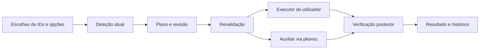

# Desenvolvimento do Meu Ubuntu

Este guia descreve arquitetura, receitas, validação e empacotamento. Para utilização, consulte [o manual](manual.md). A [referência do catálogo](catalogo.md) contém todos os itens, opções, repositórios e perfis incluídos. O alvo é Ubuntu 26.04, GNOME e amd64; outra distribuição exige backend e testes próprios.

## Preparar o ambiente

O caminho recomendado é Docker com `build/docker/Dockerfile.build`: ABI Ubuntu 26.04, bibliotecas GTK 3/WebKitGTK 4.1, Node/npm, Python e Go 1.26.9. O arquivo Go tem versão e checksum fixos. Os volumes `meu-ubuntu-gocache` e `meu-ubuntu-npm` conservam caches; dependências seguem `go.sum` e `frontend/package-lock.json`.

```sh
make check
make audit
make build
make verify
make sim
```

`make test` é um alias de `make check`. `make image` prepara a imagem, assim como os alvos de validação e build. Para usar uma imagem já construída:

```sh
docker run --rm -v "$PWD:/src" -v meu-ubuntu-gocache:/go -v meu-ubuntu-npm:/root/.npm \
  -e HOST_UID="$(id -u)" -e HOST_GID="$(id -g)" \
  meu-ubuntu-build:26.04 bash build/scripts/check-in-container.sh
```

O script confere a documentação, executa testes do filtro de perfis, compila TypeScript/Vite e depois executa `go vet` e `go test -race -tags webkit2_41 ./...`. A ordem permite um checkout sem `frontend/dist`, pois Go incorpora essa pasta. Compilar só o frontend não testa operações do sistema.

No host, instale as dependências do Dockerfile e use Go/Node compatíveis. `cd frontend && npm ci && npm test && npm run build` verifica a interface. Depois do frontend compilado, `go run -tags webkit2_41 . --simular` abre a aplicação. Um servidor Vite isolado não fornece a ponte `window.go.main.App`. `make clean` apaga `dist`, `frontend/dist` e `frontend/node_modules`, incluindo artefactos antigos.

## Estrutura

| Local | Responsabilidade |
| --- | --- |
| `main.go` | CLI, recursos embutidos, janela Wails, instância única e auxiliar administrativo. |
| `app.go` | Ponte de funções, perfis, estados, revisão, execução e informação Sobre. |
| `frontend/src/App.tsx` | Escolhas, navegação, preferências, edição e eventos. |
| `frontend/src/Catalog.tsx` | Cartões, filtros, estados, grupos exclusivos e detalhes. |
| `ProfilePicker.tsx`, `profileScope.ts` | Filtro local do catálogo e vista com dependências/alternativas. |
| `Modals.tsx`, `Wizard.tsx` | Revisão, conflitos, reversão e primeiro uso. |
| `PlanRun.tsx`, `ManualGuide.tsx` | Plano, progresso, resultados e guias copiáveis. |
| `Pages.tsx`, `HelpAbout.tsx` | Início, gestão, diagnóstico, migração, histórico, ajuda e Sobre. |
| `internal/catalog`, `profiles` | Receitas incorporadas, validação e perfis iniciais. |
| `internal/detect`, `selection`, `plan` | Deteção, combinação, dependências, conflitos e revisão. |
| `internal/engine` | Execução, verificação posterior, falhas, eventos e reversão revista. |
| `internal/helper` | Cliente pkexec e servidor de operações administrativas permitidas. |
| `internal/aptsrc`, `adminconfig` | Origens APT e ficheiros administrativos próprios. |
| `internal/sys` | Executor real e executor controlado de simulação. |
| `internal/store`, `safefile` | XDG, escrita protegida, perfis, journal, histórico e logs. |
| `internal/diag`, `inventory`, `migrate` | Diagnóstico, inventário e backup/cópia Firefox. |
| `docs/manual.json` | Fonte da ajuda offline e do manual Markdown. |
| `build/scripts` | Build, checks, auditoria, documentação, logos e revisão externa opcional. |

Os nomes abreviados do frontend acima ficam em `frontend/src/`.

## Caminho de uma operação



A seleção descreve intenção; o estado descreve o computador. O filtro Mostrar catálogo de só organiza a vista e não deve combinar escolhas nem executar operações. Minhas escolhas mostra a seleção completa, independentemente desse filtro. A pesquisa global ultrapassa esse filtro. Escolhas fora da vista continuam no plano.

O plano incorpora dependências e identifica grupos, conflitos, ações sensíveis, tarefas manuais e avisos de sessão. O `reviewToken` liga a execução à proposta revista. O executor revalida antes de agir. Scripts precisam de corresponder ao conteúdo/hash autorizado. Mudar a proposta exige revisão nova.

O journal inicia o registo antes da alteração e confirma-o depois da verificação. A reversão tem proposta e token próprios; o estado atual precisa de continuar a corresponder ao revisto. Não existe rollback geral de pacotes.

## Ponte Go e interface

`frontend/src/api.ts` documenta tipos e argumentos. O frontend envia IDs e opções, não linhas de shell. Erros Go são rejeições da chamada; conserve os diálogos e escolhas quando houver falhas.

| Funções | Contrato |
| --- | --- |
| `Init`, `About` | Sistema, versão real, preferências, catálogo, perfis, importação pendente e atribuições locais. About só lê. |
| `States`, `ItemState`, `SavePrefs` | Deteção e persistência de escolhas, tema, vista e progresso. Guardar não aplica ajustes. |
| `BuildPlan`, `ScriptPreview`, `Execute` | Proposta, instalador para revisão e execução com confirmações/token. |
| `Cancel`, `Running`, `EndSession` | Pedir interrupção, consultar execução e pedir logout/reboot explicitamente. |
| `Runs`, `RunLog`, `Changes` | Histórico e registos locais. |
| `PreviewRevert`, `RevertReviewed` | Comparação atual/alvo e reversão autorizada. `Revert` permanece por compatibilidade; não substitui a revisão. |
| `Profiles`, `SaveProfile`, `SaveImported`, `DeleteProfile` | Receitas incluídas, próprias e importadas; substituição explícita. |
| `ExportProfile`, `ImportProfile`, `ReviewProfile`, `ReviewProfileFile` | Diálogos, validação e revisão. Importar não instala. |
| `MergeSelections` | Escolhas combinadas, origens, itens acrescentados e conflitos por resolver. |
| `ParseInventory`, `OpenInventoryFile` | Classificação de lista e leitura do ficheiro escolhido. |
| `Diagnostics` | Factos e sugestões sem as aplicar. |
| `Firefox`, `FirefoxBackup`, `FirefoxMigrate`, `SSHKeys` | Deteção/cópia de perfis e fingerprints de chaves públicas. |

Eventos `run:step`, `run:log` e `run:done` atualizam a execução. `profile:review` e `profile:review-error` recebem um perfil aberto por outra invocação. Eventos podem chegar antes de `Execute` devolver o ID; conserve os eventos iniciais e não associe eventos antigos à execução atual.

O runtime Wails fornece diálogos, abertura de URLs e área de transferência. `ClipboardSetText` devolve um booleano: `false` é falha. Copiar um guia nunca o executa. O fallback de navegador serve desenvolvimento e testes.

## Acrescentar uma receita

1. Escolha um ID estável em minúsculas/hífen e uma área/categoria adequada. Mudar um ID pode deixar perfis partilhados incompletos.
2. Adicione a receita em `internal/catalog/catalog.json`: nome, resumo, justificação, método e fonte. Não prometa ganhos sem medições.
3. Declare pacotes/identificador, compatibilidade, deteção e verificação posterior. Comandos de verificação usam argumentos fixos.
4. Declare `requires`, conflitos com motivo e `hard`, ou `group` para alternativas exclusivas.
5. Declare opções com valores permitidos e padrões. Pacotes com `{opt:chave}` só podem expandir valores validados.
6. Assinale serviços, sessão/reboot, sensibilidade e confirmações. Use guias para decisões de configuração pessoal.
7. Para `apt-repo`, declare fonte oficial, URL da chave, fingerprints primários completos, suite, componentes e arquitetura.
8. Atualize perfis, documentação e logo licenciado; execute checks e valide num Ubuntu suportado com estado inicial conhecido.

| Método | Dados e efeito |
| --- | --- |
| `apt` | Pacotes Ubuntu, deteção e verificação dos pacotes/comando. |
| `apt-repo` | Repositório declarado e pacotes através do auxiliar. |
| `flatpak` | ID, instalação para o utilizador e Flathub quando necessário. |
| `gsettings` | Schema, chave, literal GVariant ou opção/mapa. Schemas relocáveis são resolvidos para o perfil local. |
| `gitconfig` | Chaves globais declaradas, sem credenciais. |
| `template` | Nome/conteúdo, sem substituir ficheiros pessoais existentes. |
| `extension` | UUID e equivalentes `providedBy`; compatibilidade GNOME. |
| `power-profile` | Alternativa suportada pelo daemon/hardware. |
| `admin` | Operação permitida `adminOp`; nova operação exige implementação e testes. |
| `manual` | Instruções/ligação, sem execução automática. |
| `npm-user` | Pacote oficial e versão fixa declarados em `npm`; instala como utilizador em `~/.local`, exige confirmação e verifica `--version`. |
| `user-script` | URL/hosts, backup, binário e verificação; executado como utilizador depois de revisão. |

Um método ou privilégio novo exige planner/executor/auxiliar, validação e testes de recusa. Não acrescente comandos arbitrários para contornar o contrato.

## Formato de perfil

```json
{
  "schema": "meu-ubuntu/profile",
  "version": 2,
  "id": "terminal-amigos",
  "name": "Terminal dos amigos",
  "description": "Ferramentas pequenas para o dia a dia.",
  "author": "Exemplo",
  "kind": "complement",
  "requires": {"minRelease": "26.04", "arch": ["amd64"]},
  "selections": {"git": {}, "nala": {}, "fzf": {}}
}
```

Também aceita `audience`, `created` e `updated`. `source` e `builtin` são informação do loader, não prova de confiança no autor. Opções seguem `"item-id": {"options": {"chave": ["valor"]}}`. Campos desconhecidos/opções inválidas são recusados; IDs desconhecidos são retirados com aviso. O limite de importação é 1 MiB. O formato v1 é migrado explicitamente para v2 com aviso.

Não inclua comandos, URLs de instalação ou segredos em perfis. Receitas novas entram no catálogo. A validação recusa campos e padrões conhecidos de segredos; não é um detetor universal de informação sensível em texto livre.

## Segurança e dados

O processo gráfico recusa root. O auxiliar exige pkexec, bloqueia operações administrativas concorrentes e valida operações conhecidas. Origens APT/chaves usam ficheiros próprios e backups; origens equivalentes são tratadas para evitar duplicação. Os fluxos de ficheiros recusam symlinks e verificam a confiança dos backups onde aplicável.

Scripts continuam a exigir confiança no fornecedor. Código como utilizador também pode afetar dados pessoais. Um hash evita mudar o script autorizado; não prova que o fornecedor é benigno.

Dados pessoais usam XDG. Backups de scripts ficam em `state/backups/`; snapshots administrativos em `/var/lib/meu-ubuntu/` e backups de sistema em `/var/backups/meu-ubuntu/`. Backups Firefox ficam em `~/MeuUbuntu-backups`. Conserve evidência para reversões e reveja logs/backups antes de partilhar.

Não existe telemetria da aplicação. Instalações usam fontes declaradas; aplicações instaladas têm comportamentos próprios. A simulação usa pastas `meu-ubuntu-sim`, home/raiz simuladas e executor controlado; não prova comportamento numa sessão GNOME real.

## Documentação e logos

```sh
python3 build/scripts/generate-docs.py
python3 build/scripts/generate-docs.py --check
```

Edite `docs/manual.json`. A ajuda renderiza texto, listas, tabelas e código, sem interpretar HTML ou comandos. O gerador escreve `docs/manual.md` e `docs/catalogo.md`; os checks recusam ficheiros desatualizados. Atualize este guia ao mudar contratos e reveja os exemplos do README.

O binário inclui a ajuda e o manual para `--manual`. O .deb inclui manual, catálogo, guia técnico, README e licenças dos logos em `/usr/share/doc/meu-ubuntu/`. Sobre lê a versão do executável.

Os SVGs são locais. `frontend/src/assets/apps/sources.json` regista origem, revisão, licença e checksum; `appLogos.json` associa IDs. Leia `build/scripts/update-app-logos.py` e as atribuições antes de atualizar. Evite downloads/CDN em tempo de execução.

## Validar alterações

Os testes Go cobrem planeamento, combinação, execução, auxiliar, ficheiros, histórico, perfis e regressões. Os testes de frontend conferem dependências/alternativas, ciclos, origens e preservação de escolhas no filtro. `make audit` usa `govulncheck` e `npm audit`; a evidência depende da data e do toolchain.

Confira a interface a 900 px, temas, teclado, falhas e estados vazios. Mocks de Wails devem ser identificados e nunca incorporados na produção. Validam cliques/mensagens, não polkit, APT, clipboard nativo ou GNOME.

Operações reais precisam de VM ou máquina autorizada com backup e estado inicial conhecido. Instalar um .deb num container valida dependências/CLI, não a abertura da janela. Repita um plano pequeno que funcionava na 0.3 e os fluxos alterados.

## Preparar uma versão

1. Atualize Makefile, package/lockfile, scripts de build/verificação e imagem de teste de execução; preserve notas históricas.
2. Gere docs e confira requisitos/licença principal. O objetivo open source requer a licença publicada.
3. Execute checks/auditoria com compilador corrigido e faça o build.
4. Confira binários, metadados .deb e `dist/SHA256SUMS`. `SOURCE_DATE_EPOCH` estabiliza timestamps; não prova sozinho builds idênticos.
5. Valide atualização numa sessão GNOME: polkit, plano, resultado, reversão, perfis e guias.
6. Registe evidência e limites. Publicar é uma ação separada do build; 1.0 exige os critérios essenciais concluídos.

`.github/workflows/check.yml` prepara checks, auditoria, build e artefactos, sem publicar automaticamente release. `build/scripts/review-adversarial.sh` oferece segunda opinião por Claude CLI quando disponível. Falha de rede/autenticação não conta como revisão concluída.

O [roteiro da 1.0 open source](../README.md#preparação-da-100-open-source) define escopo, correções e critérios de aceitação. A revisão [Astra/high de 2026-10-12](../dogfood-output/review-astra-high-2026-10-12.md) registou sete achados por inspeção; testes existentes aprovados não substituem reproduções dirigidas de falhas parciais e reversões. As regressões e a revisão final estão em dogfood-output/rc.1/. Validar também o fecho durante execução numa sessão GNOME descartável.

A versão Debian da candidata é `1.0.0~rc4`, inferior a `1.0.0`; a verificação do pacote comprova essa ordem. O build inclui GPLv3, avisos de terceiros e um arquivo de código-fonte da mesma árvore. Registe o commit e o estado da árvore usados no build; o checksum do arquivo identifica os bytes das fontes entregues. Não inclua estado local, segredos ou integrações privadas no arquivo.

O diagnóstico é recolhido e guardado como uma fotografia identificada. A exportação usa os mesmos registos normalizados em PDF/CSV/XLSX, sem recolher novamente. CSV protege células interpretáveis como fórmulas; XLSX usa texto; PDF embute DejaVu Sans e representa Unicode suplementar pelo código. Limites de tamanho são explícitos; gravação é atómica e requer a extensão escolhida.

O build gera também `dist/meu-ubuntu-<versão>-instalar.zip`, contendo apenas o .deb, o checksum desse pacote e instruções. `make verify` confere o conteúdo e recusa a inclusão de pastas `private/` ou `logs/` no arquivo de fontes. O exemplo sanitizado fica em `examples/integrations/officegest/`. Pastas locais `private/` não são versionadas; conteúdo antigo já presente no histórico permanece público.

## Reportar e contribuir

Inclua versão, sistema/arquitetura/GNOME/sessão, passos mínimos, esperado/observado e erro relevante sem dados pessoais. Para desempenho, apresente medições. Para Fedora, separe métodos de pacotes/receitas, deteção, permissões, empacotamento e matriz de testes; trocar APT por DNF não basta.

O código do projeto usa GPL-3.0-only; leia LICENSE, NOTICE.md, CONTRIBUTING.md e SECURITY.md. Dependências e assets conservam as suas licenças próprias.

## Beta de usabilidade

A candidata 1.0.0-rc.4 visa Ubuntu 26.04 LTS, GNOME e amd64. Veja o [roteiro do beta](beta-usabilidade.md) e a [avaliação da v0.5.0](../dogfood-output/v0.5.0/report.md). As versões anteriores permanecem em dist/. O pacote Debian usa 1.0.0~rc4, anterior à versão estável 1.0.0.

Receitas npm usam metadados fixos do catálogo; perfis só podem escolher IDs. Não aceite URLs, nomes de comandos ou versões livres através de perfis. A instalação preserva um agente já encontrado, não recolhe credenciais e não configura subscrições. Ao atualizar uma receita, confirme a documentação oficial, a versão npm, os requisitos de Node e uma instalação sem root.

## Preparação declarativa e pausa (RC.3)

Pacotes formato 2 podem declarar ComposeSetup; apenas IDs, caminhos relativos,
serviços, schemas, portas Redis e domínios. O manifesto nunca fornece comandos
executáveis. O script Python incorporado implementa operações fixas; build e
Composer executam código do checkout escolhido após revisão e confirmação.
A aplicação bloqueia preparações e planos concorrentes. Tokens ligam pacote,
pasta, configuração Compose, ficheiros relevantes e portas à revisão.

Configuração pessoal em XDG data/dev-environments; ficheiros originais Compose
não são reescritos. Recursos Docker recebem nomes e etiquetas próprios, redes
externas são isoladas e portas são locais. Credenciais geradas permanecem na
configuração pessoal; stdout bruto Docker/Composer não chega aos logs/IPC.
Schemas usam CREATE DATABASE IF NOT EXISTS. Redis só cria cluster em nós vazios
ou confere cluster pronto; nunca aplica reset. Dados existentes são preservados.

Pausa/cancelamento aguardam uma operação concluída. Retoma confere novamente
estado do plano ou ficheiros/configuração e propriedade dos recursos do addon.
Histórico de preparação persistido fica como interrupted após reinício;
reexecução exige nova revisão. A interface mantém progresso ao navegar.

Um lock de kernel partilhado com o processo Python impede iniciar trabalho
concorrente enquanto um filho termina a operação após crash da janela.
Reabrir aguarda esse processo; quando termina, o histórico permite nova revisão.

Os checks incluem regressões Python sintéticas, sem iniciar Docker ou alterar
um projeto real. make limita containers de build a 2 CPUs e 4 GiB por padrão;
BUILD_CPUS e BUILD_MEMORY permitem ajuste. Esse limite não identifica a causa
de um bloqueio do host, nem limita o daemon BuildKit de projetos preparados.

## Organização do repositório

README apresenta instalação, limites e navegação. docs/README.md indexa guias;
docs/contexto-projeto.md conserva evolução anterior. CHANGELOG.md regista versões
e RELEASING.md define preparação/publicação. VERSION e manifests frontend são
conferidos; set-version.py sincroniza-os. dist/ e frontend/dist/ são gerados e
ficam fora do Git, assim como estado XDG e notas locais. A CI constrói a partir
de um checkout e identifica os artefactos pela versão. Publicação é explícita.

A política Flatpak e a conservação de instalações existentes estão em flatpak.md.
Cli/serviços do host continuam com receitas próprias. Registe fontes e teste
integrações com hardware, ferramentas do host e permissões antes de anunciar prontidão.
